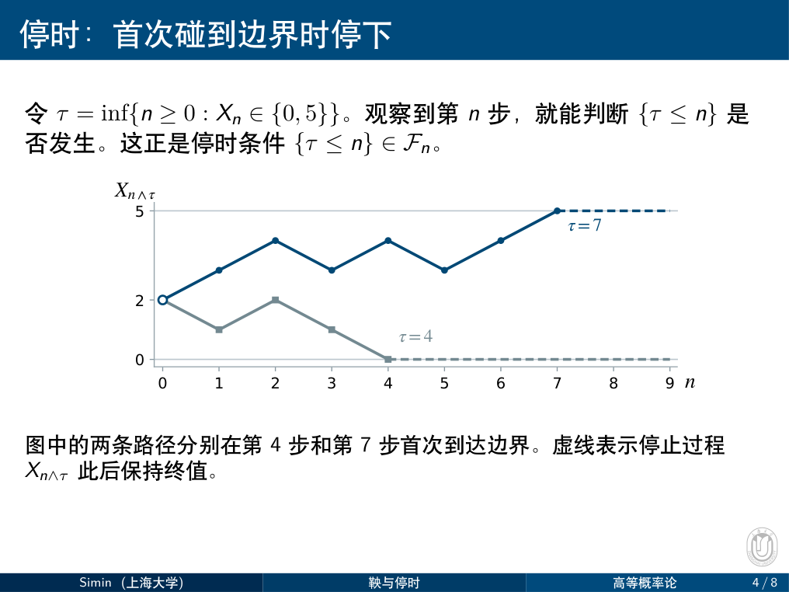

<!-- Simin -->

# 上海大学 Beamer 模板

**A Beamer Theme for Shanghai University (SHU)**

[在 Overleaf 打开](https://www.overleaf.com/docs?snip_uri=https%3A%2F%2Fraw.githubusercontent.com%2FSiminChang%2FShanghai-University-Beamer-Template%2Fmain%2FSHU-Beamer-Overleaf.zip&engine=xelatex&main_document=slide.tex) · [下载模板 ZIP](https://raw.githubusercontent.com/SiminChang/Shanghai-University-Beamer-Template/main/SHU-Beamer-Overleaf.zip) · [示例 PDF](slide.pdf) · [问题反馈](https://github.com/SiminChang/Shanghai-University-Beamer-Template/issues)

## 简介 · Introduction

本模板使用上海大学的「上大蓝」（C100、M70、Y20、K20）。封面居中展示校徽，正文使用通栏标题和右下角浅灰色校徽。底部三栏从左至右显示作者与单位、报告简称、日期与页码。

The sample lecture introduces martingales and the optional stopping theorem in discrete time. It shows how to typeset definitions, proofs, figures and references for a graduate probability course.

[](slide.pdf)

## 工程结构 · Project files

```text
slide.tex          高等概率论示例讲义，编辑报告内容的入口
SHU.sty            主题配色、标题栏与页脚
ref.bib            参考文献
pic/
├── SHU.png        封面校徽
├── SHU-gray.pdf   正文页的浅灰矢量校徽
└── sample.pdf     随机游走示意图
slide.pdf          编译后的完整讲义
preview.png        正文页预览
```

## 使用方法 · Getting started

**Overleaf**　下载源码 ZIP，在 Overleaf 首页选择 **New Project → Upload Project**。将主文档设为 `slide.tex`、编译器设为 **XeLaTeX**，然后重新编译。

**本地编译**　安装含 `ctex` 和 Fandol 字体的 TeX Live，在工程目录运行以下命令。输出文件为 `slide.pdf`。

```sh
latexmk -xelatex slide.tex
```

在 `slide.tex` 中修改 `\title`、`\author`、`\institute` 和 `\date`。花括号中的全称用于封面，方括号中的简称用于页脚。例如，`\title[高等概率论]{高等概率论：鞅与可选停止}`。默认画幅为 4:3，宽屏演示可在 `\documentclass` 选项中加入 `aspectratio=169`。

## 来源与许可 · Credits and license

- 本版由 **Simin** 维护，仓库原创内容采用 MIT 许可证。[LICENSE](LICENSE)
- 工程架构沿用 Sheng Li 的上海大学 Beamer 模板。原模板以 CC BY 4.0 发布，并致谢 Jiayi Weng 的 THU Beamer Theme。本版调整配色、标题栏和页脚，并编写高等概率论示例。[上海大学原模板](https://www.overleaf.com/latex/templates/shang-hai-da-xue-beamermo-ban/njsnkhjrmdns) · [CC BY 4.0](https://creativecommons.org/licenses/by/4.0/)
- 标题栏与三段式页脚参考 Rishit Dagli 的 UofT Slide Template。正文页的浅灰校徽由上海大学官网矢量标识转为浅灰色。[UofT Slide Template](https://www.overleaf.com/latex/templates/uoft-slide-template/xkhdjxwbwkcn) · [上海大学校徽介绍](https://www.shu.edu.cn/xxgk/sdwh/xhjs.htm)
